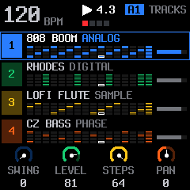
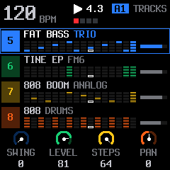
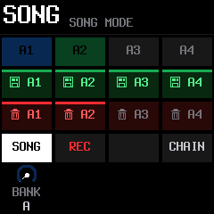
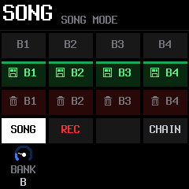
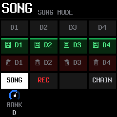
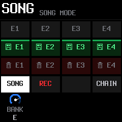
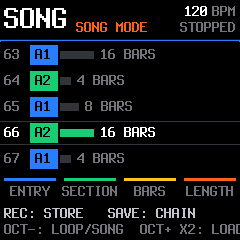
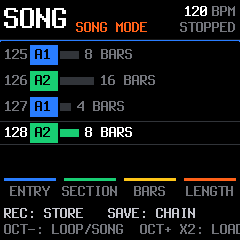
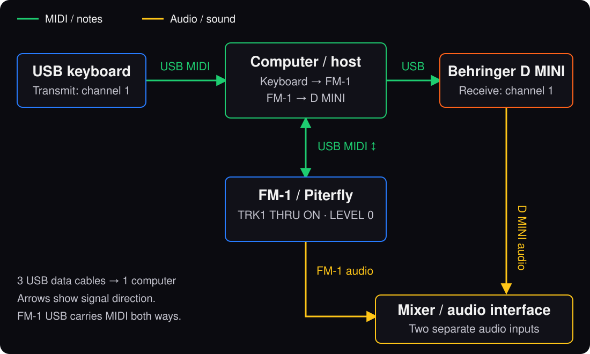

> Distribution export: historical upstream images are omitted. Original authorship, licence notices and feature descriptions are retained; see [PROVENANCE.md](PROVENANCE.md).

<p align="center"></p>

# piterfly 1.1.0 for M-VAVE FM-1

An alternative operating system built on **SLOOP 2.8.5** and its **Felucca** foundation. Seven synth parts and a dedicated drum track, with a clearer interface and more room to build a live set.

**Tested on a physical FM-1 and accepted by the project owner on 2026-11-13.**

[Polski: instrukcja i zmiany](docs/PITERFLY.md) · [1.1.0 release notes](docs/RELEASE-1.1.0.md) · [Track controls](docs/SEVEN-SYNTH-TRACKS.md) · [Live granular](docs/LIVE-GRANULAR.md)

## The FM-1 device interface

These are **240 × 240 renders of the actual firmware UI**, with illustrative music data. They show the screens displayed on the FM-1, rather than a desktop editor. They are not camera photographs of the hardware display. [Illustrated guide](docs/PITERFLY.md) · [Full device-screen gallery](docs/SCREENSHOTS-1.1.0.md).

**HOME displays tracks in two groups: 1–4 and 5–8.** Tracks 1–7 are synth parts; track 8 is drums.

| Tracks 1–4 | Tracks 5–8 |
| --- | --- |
|  |  |

**24 pattern slots: six SAVE banks, A–F, each with four slots.** The device shows one bank at a time. Hold SAVE and turn KNOB 1 to change banks.

| A1–A4 | B1–B4 | C1–C4 |
| --- | --- | --- |
|  |  |  |

| D1–D4 | E1–E4 | F1–F4 |
| --- | --- | --- |
|  |  |  |


**SONG reaches position 128.** These screens show entries 63–67 and 125–128 in an illustrative arrangement that reuses patterns A1 and A2.

| Beyond position 64 | Final position 128 |
| --- | --- |
|  |  |

The 128 SONG positions reuse the 24 stored patterns. Note sequences retain their separate 64-step capacity.

## Make a larger arrangement

- **Seven normal synth tracks plus drums.** Each synth part has its own engine, sound, sequencer, effects and MIDI routing. Eight synth voices are shared across the seven parts; drums have their own voices.
- **24 complete patterns**, A1–F4, and **128 SONG positions**, each playing a pattern for 1–64 bars. SONG REC captures pattern changes and their duration. Quick CHAIN retains eight entries.
- **Up to 64 note steps per track**, shown in their real positions. Playback outlines and editing corners remain distinct; track frames, recording indicators and page dots make the interface easier to follow. The 64-step limit comes from SLOOP; the complete visualisation is a piterfly interface improvement.

## Shape the performance

**GRANUL** is a live INSERT on each track: size/density, pitch/mix, position/spread and LIVE/FREEZE. Preset changes preserve an active effect and frozen history. Both processor cores share render work according to measured track cost. At MIX 0, capture pauses after its fade; earlier history remains available when MIX rises again.

**Per-track DUCK** lets you select which synth parts respond to the kick. Select a synth track, open FX → FILTER, and use knob 2 for DUCK ON/OFF. MASTER → DUCK sets the overall depth.

## Add physical instruments

[](assets/piterfly/midi-rig.svg)

MIDI THRU forwards incoming Note On/Off and velocity on each part's assigned channel. Use an external synth such as the Behringer D MINI alongside the FM-1's internal sounds. For an external-only part, enable its THRU and set its internal LEVEL to zero. OUT = SEQ sends recorded patterns too.

USB connections require a computer or MIDI host. Connect keyboard, FM-1 and D MINI separately to the host with three USB data cables. In the MIDI router, route keyboard → FM-1 and FM-1 → D MINI. Each instrument's audio goes separately to the mixer; MIDI does not carry their audio. The FM-1 TRS connector is MIDI input; forwarded MIDI leaves over USB.

[Mac/MidiPipe setup](web/midipipe.html) · [MIDI protocol](web/EDITOR_PROTOCOL.md)

## Install 1.1.0

Use the matching [1.1.0 installer](https://piotrwozniak.github.io/piterfly/webapp/installer/) and [browser editor](https://piotrwozniak.github.io/piterfly/webapp/editor/). Download the firmware and matching sources from [GitHub Releases](https://github.com/piotrwozniak/piterfly/releases/tag/1.1.0). See [release contents and build instructions](docs/RELEASE-1.1.0.md).

**Back up before upgrading from an older layout.** USR1 remains an 80 KiB sample bank. USR2/3/4 are used for persistent patterns. Factory samples and SYN1–SYN4 remain available. FUN1–FUN7 patterns are imported into FUN9; old drum data moves to track 8 and added synth parts start empty. Captured audio inside live effects is temporary; notes, sounds, patterns and settings are persistent.

Importing a song replaces all 24 pattern slots and the working loop, including empty slots. Keep your backup when returning to an older firmware layout.


## Build and source

```sh
sh build.sh --release 1.1.0
sh tests/run_tests.sh
```

See [BUILDING.md](BUILDING.md) for the pinned SDK/toolchain, simulator and browser audio build. Release preparation provides the firmware, exact source archive, notices and SHA-256 checksums. The updater identity for 1.1.0 is **FM-1_1120101**; the editor protocol is **17**, project format **FUN9**, settings format **PER4**.

## Credits and licence

piterfly retains the original SLOOP and Felucca authorship, including Leo Kuroshita (@kurogedelic), Hügelton Instruments, and the dual-core work credited in the source. Code and piterfly artwork are GPL-3.0-only except for separately listed components and assets.

[LICENSE](LICENSE) · [Licensing and provenance](LICENSING.md) · [Third-party notices](THIRD_PARTY_NOTICES.md) · [Artwork provenance](docs/ICON-RIGHTS.md)

Historical SLOOP guides remain in [GUIDE.md](GUIDE.md) and [SLOOP.md](SLOOP.md); the 1.1.0 documentation above takes precedence for piterfly's track count, storage layout and controls.
