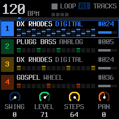

<p align="center"></p>

# piterfly 1.2.7 for M-VAVE FM-1

An alternative operating system based on **SLOOP 2.8.5** and Felucca. Version 1.2.7 has **six synth parts and two independent drum tracks**.

**Release 1.2.7** adds USB MIDI Host mode for controlling one external synth through a powered USB hub. USB Host has passed software tests and awaits a test on a physical FM-1.

[Polska instrukcja](docs/PITERFLY.md) · [Track controls](docs/TRACKS.md) · [1.2.7 notes](docs/RELEASE-1.2.7.md) · [Granular controls](docs/LIVE-GRANULAR.md)

## Tracks and controls

- **Tracks 1–6: synths**, with independent engines, sounds, sequences, effects and MIDI routing. They share eight sounding synth voices.
- **Tracks 7 and 8: drums**, each with six drum voices, its own kit selection, 16 lanes, 64-step pattern, lane tuning/decay, level, pan, sends, filter, slicer and insert. Hi-hat choke stays within its track. SYN1–SYN4 kit definitions and sample libraries are shared; kit selection and lane settings are independent.
- HOME shows groups **1–4** and **5–8**. PRESETS selects a track on ordinary pages; ALGORITHM changes its sound or drum kit. In NOTES, PRESETS controls zoom and ALGORITHM selects the track.
- **24 patterns**, A1–F4, and **128 SONG positions**, each playing a pattern for 1–64 bars. Hold SAVE and turn KNOB 1 to select bank A–F. The quick chain holds eight entries.
- Each track retains up to **64 steps**, with micro timing, fill conditions and parameter locks.

Select track 7 or 8 to edit that drum part on the DRUMS pages. Track 7 uses its own track LEVEL/REV/DLY parameters; track 8 retains the existing global drum controls. The matching editor routes these controls independently.

Live pattern selection waits for the complete longest track cycle (LEN and DIV, rounded up to whole bars). A 64-step loop at 1/16 switches after four bars. Switching retains edits to the outgoing pattern, including its instruments and kits; stop and wait for **PATTERNS SAVED** to commit them to flash. A full four-slot edit cache refuses switching with **STOP TO SAVE MORE**.

HOME restores the original 36-pixel track rows starting at y=40, the original step sizes, text positions and bottom controls. Only a thin instrument-position line/block is added in the previously empty header rows y=35–37. The extra 24-pixel name/counter strip and per-track number labels from 1.2.2–1.2.3 are removed. LEVEL, STEPS and PAN recall and full-length pattern switching remain fixed.



## Effects

**GRANUL** is available independently on all eight tracks. Knob 1 selects the insert type; knob 2 selects SIZE/DENSITY, PITCH/MIX, POS/SPREAD or CAPTURE/BUF; knobs 3 and 4 edit the pair. BUF displays the currently available history. Captured audio is temporary; effect settings are saved.

**DUCK** targets the six synth parts. Select a synth, open FX → FILTER and use knob 2 for DUCK ON/OFF. MASTER → DUCK controls overall depth. Kicks from either drum track trigger ducking; the drum tracks are not DUCK targets.

## Saved songs

**Eight named song slots**, subject to available memory. On SONG, turn ALGORITHM to open the list; K1 selects a slot, K2 a name position and K3 a character. SAVE stores, OCT+ loads, OCT− deletes; repeat to confirm replacement/load/delete. The editor’s Song page also exports a selected saved song to a `.sloopsong` file on your Mac. Export does not delete it.

With playback stopped, press **REC twice** on the SONGS list to start an empty working song. The named songs stay available. On the SONG order page, the selection outline follows the pattern colour. After holding **REC** to clear an individual track, **CLEAR SAVED** confirms the flash write.

The shared pool is **352 KiB**. Only nonempty stored patterns are pinned, together with the working loop and song order. Unchanged patterns can be shared between saved songs. The list shows free KiB and reports **NO SPACE: EXPORT/DELETE** without replacing an earlier song. See [capacity, controls and export scope](docs/SONGS.md).

## MIDI and external instruments

Default MIDI channels are **1–6 for synths, 7 for drum track 7, and 10 for drum track 8**. Set track 7 through CH7 and track 8 through DRUM CH. Every track retains its own THRU switch and MIDI Learn routing.

**USB Host** lets the FM-1 play one USB MIDI synth, such as a JT-4000 or JT-4000M, through a powered hub. Hold HOME, turn SELECT to **USB**, and turn **knob 3 (USB HOST)** to the right. Wait for **MIDI READY**, match the synth's receive channel to the track, and set **GLO → MIDI 2 → OUT = SEQ** to send patterns. TRS MIDI IN can still drive the FM-1 and use the tracks' THRU switches. Use the synth's own audio output.

For a computer setup, turn USB HOST off and connect the keyboard, FM-1 and external synth to the computer or MIDI host. Route keyboard → FM-1 and FM-1 → external synth. For an external-only part, enable its THRU and set internal LEVEL to zero; OUT = SEQ also sends recorded patterns. The FM-1 TRS connector is MIDI input; forwarded MIDI leaves over USB. MIDI does not carry the external instrument's audio.

[USB MIDI Host setup](GUIDE.md#play-a-usb-synth-from-the-fm-1) · [Mac/MidiPipe setup](web/midipipe.html) · [MIDI protocol](web/EDITOR_PROTOCOL.md)

## Build version 1.2.7

```sh
sh build.sh --release 1.2.7
sh tests/run_tests.sh
```

The local firmware package is `build/felucca-1.2.7.fwsc`. Use an editor supporting **protocol 19**; the 1.2.0 editor remains compatible. See [BUILDING.md](BUILDING.md) for dependencies and [release notes](docs/RELEASE-1.2.7.md). [Download release 1.2.7](https://github.com/piotrwozniak/piterfly/releases/tag/1.2.7) or use the [public installer](https://piotrwozniak.github.io/piterfly/webapp/installer/). The local bundle is `build/releases/piterfly-1.2.7/`, including firmware, exact sources, licences and checksums.

**Compatible with 1.2.0 projects.** This version uses **FUNB, 6,160 bytes**, and deliberately does not import FUN1–FUNA projects. Settings remain **PER4**. All four user-sample banks now store patterns and named songs; factory samples remain. The updater identity remains **FM-1_1120101**. Song import replaces all 24 pattern slots and the working loop, including empty slots.

Software tests cover USB MIDI output through a simulated hub, reconnects, stuck-note cleanup and switching back to USB device mode.

## Earlier releases and screenshots

[1.1.0 release notes](docs/RELEASE-1.1.0.md), [publication record](docs/PUBLICATION-1.1.0.md), [7+1 implementation](docs/SEVEN-SYNTH-TRACKS.md) and [1.1.0 screen gallery](docs/SCREENSHOTS-1.1.0.md) describe that historical release. Its screenshots do not demonstrate the new drum track 7. Historical SLOOP guides remain in [GUIDE.md](GUIDE.md) and [SLOOP.md](SLOOP.md).

## Credits and licence

piterfly retains the original SLOOP and Felucca authorship, including Leo Kuroshita (@kurogedelic), Hügelton Instruments, and the dual-core work credited in the source. Code and piterfly artwork are GPL-3.0-only except for separately listed components and assets.

[LICENSE](LICENSE) · [Licensing and provenance](LICENSING.md) · [Third-party notices](THIRD_PARTY_NOTICES.md) · [Artwork provenance](docs/ICON-RIGHTS.md)
