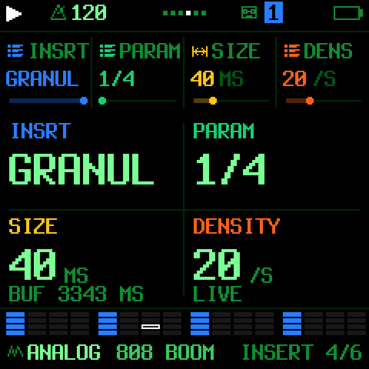
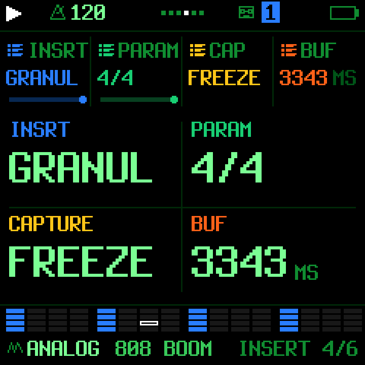

# Live granular INSERT

Included in piterfly 1.0.0 on `main`. The initial implementation was developed
on `codex/live-granular-fx` and is already part of main; no feature-branch checkout is needed.
This is an experimental firmware build. Desktop and target-build checks are not a substitute for a timing/listening test on a physical FM-1.

## Use

On HOME, FX and other parameter pages, **PRESETS** selects a track and **ALGORITHM** browses its sounds (drum kits on track 4). The active NOTES editor retains PRESETS for zoom and ALGORITHM for track selection. SONG, system settings and held-button controls keep their specific assignments.

Select a track, open **FX → INSERT**, turn knob 1 (INSRT / TYPE) to **GRANUL**. This is the normal INSERT page, alongside FLANG and the other insert types. It works on all three synth tracks and the drum track, independently of instrument engine.

**Knob 1 (INSRT)** always selects the effect type. **Knob 2 (PARAM)** selects one of four parameter pairs; **knobs 3 and 4** edit that pair. **SELECT** navigates between FX pages normally. The pair selector is local to INSERT, not another FX page. Buffer capacity and LIVE/FREEZE remain visible with every pair. Pair 4 shows them directly, without repeating a status line.

| PARAM | Knob 3 | Knob 4 |
| --- | --- | --- |
| 1/4 | SIZE: requested grain length, 10–800 ms | DENSITY: requested starts, 1–60/s |
| 2/4 | PITCH: −12 to +12 semitones | MIX: dry / wet, 0–100% |
| 3/4 | POS: position within available history, 0–100% | SPREAD: random position spread, 0–100% |
| 4/4 | CAPTURE: LIVE / FREEZE | BUF: assigned capacity, read-only |

Changing a factory sound, engine or user sound keeps an already active GRANUL insert and all its parameters. FREEZE retains the captured audio; LIVE continues capturing the new sound. Loading a project still replaces its settings and clears volatile audio. When GRANUL is not active, presets retain their normal insert-loading behaviour.

GRANUL uses the same column renderer, margins, value baselines and dividing lines as CHOR. Buffer/capture status fits below the lower values without adding another divider; pair 4 shows the same information directly, without duplication.

Parameter changes redraw only the changed cells, without blanking the panel or redrawing the header/footer. A page or insert-type change still redraws the layout.

SIZE and PITCH use discrete named values. There are at most **four simultaneous grains per track**. Starts are spaced to respect that overlap limit; a start is skipped when all four are active. High requested density and long grains cannot exceed that bound. Grain length/position are also constrained by currently valid history and safe distance from the write head. The displayed SIZE is the request, not a promise that an empty/short buffer can already produce that length.

FREEZE holds the source history while grains continue. Changing LIVE/FREEZE and reallocating history fades the wet transition. On a synth track, the frozen effect continues after the source voices end. Mute still mutes the track. MIX 0 is bit-exact dry once its short ramp ends; the history can continue recording. A track with TYPE GRANUL retains its memory share even at MIX 0. Choose another TYPE to release that share.

The drum track has one mono granular source/wet signal. Dry stereo remains stereo as MIX blends; at 100% the granular wet is mono, and wet sends use the drum track's global reverb/delay send settings. This is one instance, not four separately frozen drum/send channels. Existing delay/reverb/chorus/slicer/punch functionality and all four tracks remain available.

## Memory and changing track count

The audio-history pool is **72 KiB**, in 72 independently mapped 1 KiB pages: 32 KiB in main RAM and 40 KiB in POOL. It stores mono **22,050 Hz, 8-bit µ-law**. Source capture is filtered by a 23-tap FIR before decimation; grain output remains at the normal 44.1 kHz output rate. Linear interpolation and a Hann window are used for each grain.

| Tracks with TYPE GRANUL | Pages per track | History shown on the device |
| --- | ---: | ---: |
| 1 | 72 | 3343 ms |
| 2 | 36 | 1671 ms |
| 3 | 24 | 1114 ms |
| 4 | 18 | 835 ms |

These are capacities, not how much audio has already been captured. A larger share fills over time. Page ownership is changed by core 0 before dispatching render jobs to core 1. On shrink, the newest complete pages and the current partial page are kept; part of the oldest partial page may be dropped to avoid copying sample data in the interrupt. Existing grains fade through the repartition. FREEZE does not protect history from shrinking when another track enables GRANUL.

The extra memory comes from drawing the screen in 32-row bands instead of keeping a 124-row RGB565 canvas. The canvas drops from 59,520 to 15,360 bytes, saving 44,160 bytes. It is never shared with audio; LCD DMA finishes before the drawing scratch is reused. The 8 KiB minimum POOL reserve remains in force.

At the measured target build: image 581,308 bytes; main RAM 96,988 / 98,304; low RAM 23,760 / 29,384; POOL 330,732 / 344,064. Rebuild before relying on these numbers after further code changes.

## Quality and processor cost

µ-law is lossy. Each captured sample uses one byte rather than PCM16's two, doubling history for a given sample rate. Its nonlinear amplitude mapping gives quieter signals more precision than a simple linear 8-bit truncation, but it does not preserve 16-bit resolution. Quantisation noise/distortion can be audible, especially on tails, freeze and transposed material. It does not itself reduce sample-rate bandwidth. The separate 22.05 kHz capture rate limits bandwidth to below 11.025 kHz; the FIR transition/filter rolloff further affects the top end.

Only the granular source/wet path uses this representation. Dry audio and the other effects retain their existing formats. On a generated pad, comparing an identically filtered 22.05 kHz PCM16 source with its µ-law round trip gave **37.43 dB signal/error ratio**, maximum difference 512 PCM16 units. This is one signal-specific error measurement, not a perceptual quality score, a general codec guarantee or an FM-1 CPU benchmark. Comparison files are generated under `build/granular-study/`.

Capture encoding, two sample decodes per interpolated grain read, windowing, summing and filtering all cost CPU. The live processor is limited to four grains/track; skipped starts bound the work. There is no measured hardware CPU percentage yet.

The device console reports, for the selected track:

- `grain_buf_ms`: assigned history capacity;
- `grain_block_max_us`: maximum granular processing time per DSP block;
- `grain_block_avg_us`: rolling accumulated average (counter restarts after 65,536 calls).

These use the existing crystal-derived 24 MHz timer. Also observe total `audio_max_us`, DMA late counters, `voices_shed`, core-1 timeouts and stack guards under heavy instrument/effect/USB load. Per-track timings omit layout changes and are not the whole audio deadline cost. Profiling is required with one and four instances and with core 1 disabled; a 256-frame half has approximately 5.805 ms total budget.

## Storage and compatibility

Projects are **FUN7, 3832 bytes**, still within the 3840-byte journal payload. The three source controls are inserted before the engine parameters; legacy engine parameter IDs/locks are mapped during conversion. At boot, all 24 FUN6 journal slots are converted using append-before-erase journal writes; interrupted conversion retries on a subsequent boot. FUN1–FUN6 import remains supported. Old firmware cannot read FUN7 projects: keep a backup made before upgrading if rollback matters.

User-preset records retain their 192-byte bank layout. Version 2 packs byte-range common parameters so all 74 parameters fit; legacy version-1 records remain readable. Older firmware cannot use version-2 records. The web editor rejects restoring those banks to pre-v15 firmware before any writes. INFO reports protocol **15**, P_COUNT **74**, P_E0 **66**. Engine MIDI-LEARN codes are already independent of P_E0, so those mappings keep their meaning.

Settings, including CAPTURE state, are saved in projects/presets. Recorded history is volatile and is never continuously written to flash. Loading a project clears history, including FIR state; a restored FREEZE starts empty until the user switches back to LIVE and captures audio.

## Verification

- Address/undefined-behaviour sanitizers: full-range codec checks, 400 page repartitions with sample-history preservation, LIVE/FREEZE, pitch/size/position extremes, bounded output, dry bypass. The isolated granular tests enable all UBSan checks. Complete-mixer integration uses the repository's existing fixed-point DSP exclusions for signed shift bases/overflow, matching `editor_fuzz.sh`; bounds, address and other undefined-behaviour checks remain enabled. It also verifies that a frozen cloud keeps sounding after all source voices end.
- NOR simulation: all 24 FUN6 slots, engine-lock mapping, repeat boot without rewriting, interrupted migration and retry, granular settings round trip.
- UI harness: type entry/defaults, four parameter pairs, normal SELECT navigation, FREEZE control, capacity updates, TYPE exit, pixel bounds and existing UI fuzz. A pixel comparison verifies that GRANUL retains CHOR’s dividing lines in all four pairs. Drawing instrumentation verifies no LCD clearing or writes to the header/footer when editing, and no writes to unchanged cells.
- Preset regression: factory/user/engine changes retain all active GRANUL parameters and history; frozen audio keeps sounding, LIVE capture continues, and other insert types retain normal preset behaviour.
- Two-core host simulation: identical audio hashes for one-core and threaded render with four instances, freeze and live changes of instance count. ThreadSanitizer checks concurrent rendering.
- Existing engine loop-cost estimates match a freshly built `master e2c7540`; stale pre-master reference budgets were refreshed and live granular functions added. These static counts are regression guards, not CPU cycle measurements.

No physical-device timing, audible dropout assessment or LCD responsiveness measurement has been completed yet.
