# piterfly — zmiany względem SLOOP

piterfly to rozwijana w tym repozytorium wersja firmware dla **M-VAVE FM-1**, oparta na **SLOOP 2.8.5**, a pośrednio na Felucca. Wersja **1.1.0** oferuje **siedem ścieżek syntezatora i osobną perkusję**. Została sprawdzona na fizycznym FM-1 i zaakceptowana przez autora projektu 13 listopada 2026. Poniżej opisano funkcje obecne w `master`, w tym granular na żywo; nie jest to opis oficjalnego wydania SLOOP.

**Gałki tracka i barwy:** na HOME, FX i pozostałych zwykłych stronach parametrów PRESETS wybiera track, a ALGORITHM zmienia jego barwę/preset (na perkusji — zestaw). W aktywnym edytorze NOTES oba pokrętła miały już funkcje: PRESETS nadal zmienia zoom, ALGORITHM wybiera track. SONG, menu ustawień i kombinacje z przytrzymanymi przyciskami zachowują swoje przypisania. Podczas swobodnego nagrania wybór tracka pozostaje zablokowany.

## Porównanie

| Obszar | Bazowy SLOOP 2.8.5 | piterfly |
| --- | --- | --- |
| Ścieżki syntezatora i perkusja | 3 + 1 | **7 + 1**, ze wspólną pulą 8 głosów syntezatora |
| Zapisane patterny całego urządzenia | 4, A–D | **24**, A1–F4, sześć banków po cztery |
| Kolejność SONG | Do 16 pozycji | **Do 128 pozycji**, po 1–64 takty |
| Kroki jednego tracka | Do 64 | Do 64 — to istniejąca funkcja SLOOP, nie nowy limit |
| Własne sample | 4 banki po 80 KiB | **USR1: 80 KiB**; USR2/3/4 przeznaczono na patterny |
| HOME | 16 pól: skrót dłuższego patternu lub bieżąca szesnastka | Wszystkie kroki w rzędach po 16, również podczas odtwarzania |
| Dolny pasek w GLO i innych menu parametrów | Jedna szesnastka; znacznik niewidoczny poza nią | Wszystkie kroki wybranego tracka i znacznik do kroku 64 |
| REC READY i podgląd tracków przy free take | Długi track ściskany do 16 pól | Osobne rzędy po 16 rzeczywistych kroków |
| Nawigacja po stronach parametrów | Licznik przy tytule na dole | Dodatkowo kompaktowe kropki na środku górnego paska |
| MIDI THRU | Bez osobnych przełączników tej wersji | **TRK1–TRK7 i DRUM ON/OFF**, na stronach MIDI THRU i THRU 4-7 |
| Oznaczenie urządzenia i interfejsu | SLOOP / Felucca | Logo arcade **piterfly**, nazwy USB `piterfly` i `piterfly Update` |

Pattern przechowuje cały loop: wszystkie osiem tracków, ich nuty, brzmienia i miks. **24 patterny nie oznaczają 24 kroków ani 24 tracków.**

## Ekrany wyświetlane na FM-1

Ilustracje w tej instrukcji odwzorowują **ekran urządzenia 240 × 240 pikseli**. Powstają z tego samego kodu UI firmware, który działa na FM-1; nie są zrzutami edytora WWW ani zdjęciami fizycznego wyświetlacza. Dane muzyczne są przykładowe. Kliknięcie obrazu otwiera jego pełny plik.

### HOME: grupy ścieżek 1–4 i 5–8

Na urządzeniu widać jednocześnie cztery ścieżki. Wybór ścieżki pokrętłem **PRESETS** przełącza grupę. Pierwszy ekran pokazuje **1–4**, drugi **5–8**, z perkusją pod numerem 8. Ścieżki 1–7 są syntezatorami.

| HOME: ścieżki 1–4 | HOME: ścieżki 5–8 |
| --- | --- |
| <a href="../assets/piterfly/screenshots/home-64.png">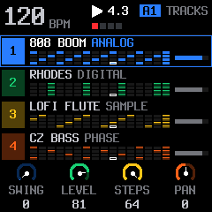</a> | <a href="../assets/piterfly/screenshots/home-tracks-5-8.png">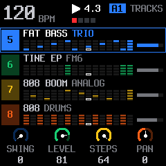</a> |

### SAVE: sześć banków i 24 sloty patternów

Przytrzymaj **SAVE**, aby otworzyć warstwę klawiszy z tytułem **SONG** i bankiem patternów. **KNOB 1** wybiera bank A–F. Krótkie naciśnięcie SAVE otwiera osobną stronę kolejności SONG z ponumerowanymi pozycjami. Każdy ekran pokazuje cztery sloty bieżącego banku; komplet sześciu ekranów poniżej pokazuje wszystkie **A1–F4**, czyli **24 miejsca** na patterny. FM-1 nie pokazuje ich jako jednej siatki 24 kafelków.

Górny rząd wybiera pattern. Zielony rząd służy do zapisu, czerwony do kasowania. W przykładzie A1 i A2 są zajęte, a pozostałe sloty puste; przygaszone nazwy nadal wskazują dostępne adresy.

| SAVE: bank A — A1–A4 | SAVE: bank B — B1–B4 | SAVE: bank C — C1–C4 |
| --- | --- | --- |
| <a href="../assets/piterfly/screenshots/save-bank-a.png">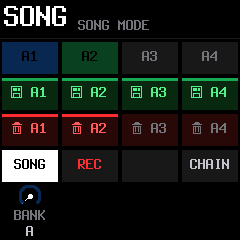</a> | <a href="../assets/piterfly/screenshots/save-bank-b.png">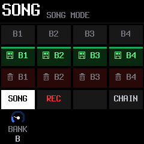</a> |  |

| SAVE: bank D — D1–D4 | SAVE: bank E — E1–E4 | SAVE: bank F — F1–F4 |
| --- | --- | --- |
| <a href="../assets/piterfly/screenshots/save-bank-d.png">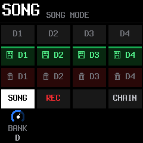</a> | <a href="../assets/piterfly/screenshots/save-bank-e.png">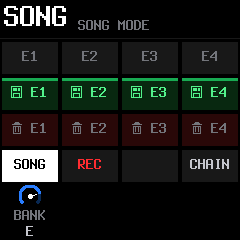</a> |  |

### SONG: przejście ponad pozycję 64 i koniec przy 128

To rzeczywisty układ strony SONG na FM-1: pięć wierszy kolejności, numer pozycji, nazwa patternu i liczba taktów. W przykładzie kolejność ma 128 pozycji odwołujących się do A1 i A2. Po lewej widać pozycje **63–67**, po prawej **125–128**.

| SONG: pozycje 63–67 | SONG: ostatnia pozycja 128 |
| --- | --- |
| <a href="../assets/piterfly/screenshots/song-positions-63-67.png">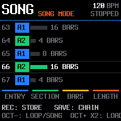</a> | <a href="../assets/piterfly/screenshots/song-position-128.png">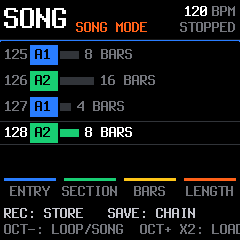</a> |

**Pozycje SONG** układają zapisane patterny w aranżację. Każda określa pattern i 1–64 takty odtwarzania. To osobna pojemność od **64 kroków nutowych ścieżki**.

### 64 kroki w menu i przy nagrywaniu

Dolny podgląd w GLO oraz widok REC READY zachowują rzeczywiste pozycje kroków w rzędach po 16.

| GLO: wybrana ścieżka | REC READY: pełne kroki |
| --- | --- |
| <a href="../assets/piterfly/screenshots/glo-64.png">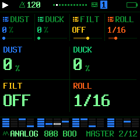</a> | <a href="../assets/piterfly/screenshots/rec-ready-64.png">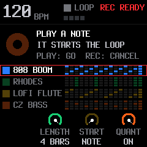</a> |

[Pełna galeria ekranów urządzenia](SCREENSHOTS-1.1.0.md) pokazuje także wszystkie pary parametrów GRANUL, DUCK oraz kanały i THRU dodanych ścieżek.

## Patterny i przycisk SAVE

Przytrzymaj **SAVE**, żeby otworzyć warstwę patternów. **Pierwszym z czterech pokręteł parametrów (KNOB 1)** wybierasz bank A–F. Nie chodzi o pokrętło SELECT.

Białe klawisze liczymy od lewej, od F3, jako 1–16.

| Białe klawisze przy trzymanym SAVE | Działanie |
| --- | --- |
| 1–4 | Wybór jednego z czterech patternów bieżącego banku |
| 5–8 | Zapis aktualnego loopa; na ekranie zielone dyskietki |
| 9–12 | Kasowanie odpowiedniego patternu; na ekranie czerwone kosze |
| 13 | Przełączenie LOOP / SONG, o ile nie trwa SONG REC |
| 14 | Uzbrojenie albo zakończenie SONG REC |
| 15 | Bez przypisanej akcji |
| 16, kafelek CHAIN | Otwarcie edytora kolejności SONG |

Podświetlają się wyłącznie **klawisze 1, 5, 9 i 13**, wskazując początki czterech grup. Kolory zielony i czerwony dotyczą ekranu. Obecny sterownik klawiszy obsługuje jasność, ale nie wybór kolorów RGB.

Wczytanie podczas grania następuje na początku następnego taktu, a przy zatrzymanym odtwarzaniu — od razu. W aktywnym trybie odtwarzania SONG ręczne przełączanie patternów jest blokowane.

Nadpisanie zajętego miejsca wymaga ponownego naciśnięcia tego samego klawisza zapisu w ciągu trzech sekund. Puszczenie SAVE, zmiana banku lub wybranie innej operacji kasuje potwierdzenie.

Kasowanie także wymaga drugiego naciśnięcia w ciągu trzech sekund, przy nadal trzymanym SAVE. Trzeba zatrzymać odtwarzanie. Aktualny roboczy loop pozostaje, ale **skasowanie zapisanego patternu nie ma Undo**. Jego pozycje są usuwane z kolejności SONG; jeżeli lista stanie się pusta, wraca domyślna kolejność.

Krótkie SAVE na HOME lub stronie DRUMS otwiera SONG. Na innych stronach może otwierać rodzinę menu SAVE; na samej stronie SONG zapisuje kolejność. Dostępne pozostaje także menu **SAVE → SECTION**, z wyborem A1–F4, kasowaniem, wczytaniem i zapisem.

## SONG, CHAIN i REC ARMED

SONG jest listą do **128 pozycji**. Każda wskazuje jeden z 24 patternów i długość 1–64 taktów. Ten sam pattern może pojawiać się wiele razy.

Przykład: A1 przez 4 takty → A2 przez 8 → A1 przez 4 → B3 przez 8.

Na stronie SONG cztery pokrętła oznaczają:

1. **ENTRY** — pozycja na liście.
2. **SECTION** — przypisany pattern A1–F4.
3. **BARS** — liczba taktów tej pozycji.
4. **LENGTH** — liczba pozycji całej listy, do 128.

Krótkie SAVE na tej stronie zapisuje kolejność. OCT− przełącza LOOP / SONG. Pozostałe funkcje strony, w tym zapis patternu przez REC i wczytanie po potwierdzeniu OCT+, pochodzą z SLOOP.

**REC ARMED pod SAVE** oznacza gotowość SONG REC do nagrywania kolejności przełączanych patternów. Nagrywanie rusza na początku taktu podczas odtwarzania wybranego zapisanego patternu. STOP lub ponowne SAVE + 14 kończy nagrywanie; wynikiem jest kolejność SONG wraz z czasami grania. To nie jest nagrywanie audio ani nowych nut.

**REC READY** to inny ekran: gotowość do nagrywania nut / free take, obsługiwana zwykłym przyciskiem REC.

Szybki CHAIN pozostaje odrębną funkcją: podczas grania loopa trzymaj SAVE, wybierz kolejno co najmniej dwa patterny i puść SAVE. Kolejność zostanie zapętlona. **Ten szybki łańcuch ma nadal limit 8 pozycji**; limit 128 dotyczy zapisywanej listy SONG.

## Jak czytać kroki

Na HOME każdy track ma własną siatkę. W dolnym pasku stron parametrów widzisz siatkę aktualnie wybranego tracka. REC READY stosuje taką samą zasadę rzędów:

- do 16 kroków: jeden rząd;
- 17–32: dwa rzędy;
- 33–48: trzy rzędy;
- 49–64: cztery rzędy.

Czytaj od lewej do prawej, następnie kolejny rząd. Pole w kolorze tracka oznacza nutę lub uderzenie; ciemne pole oznacza brak nowego zdarzenia. Nie jest to wykres głośności ani długości wybrzmiewania nuty.

**Biała obwódka** wskazuje krok aktualnie odtwarzany. W dolnym pasku **żółte narożniki** wskazują krok wybrany do edycji; na żółtym wypełnieniu są białe. Oba oznaczenia mogą występować równocześnie. Kolor nuty pozostaje wewnątrz pola.

Przykład dolnego paska: odtwarzany krok ma białą obwódkę, a wybrany do edycji — żółte narożniki.

Wybór ścieżki przełącza widoczną grupę HOME: 1–4 lub 5–8. Ścieżka 8 jest perkusją. PRESETS wybiera ścieżkę, ALGORITHM — jej brzmienie. Przy trzymanym GLO drugi czarny klawisz przełącza grupę obsługiwaną klawiszami mute/solo i czterema pokrętłami poziomów.

Widok **STEPS po przytrzymaniu SEQ** i siatka edycji **DRUMS** nadal pokazują po 16 kroków na stronę. Jest to celowe: każdemu krokowi odpowiada fizyczny biały klawisz. OCT− / OCT+ przełącza strony. W warstwie SEQ nie trzymaj wtedy klawisza kroku, bo kombinacje mają także funkcje edycji.

Na HOME wybrany track ma cienką, **stałą ramkę w kolorze swojego kafelka**, zgodnie z motywem. Podczas nagrywania ramka nagrywanego tracka staje się **czerwona** i pojawia się **REC**; po zakończeniu wybrany track wraca do swojego koloru. Ramka nie miga i nie używa etykiety ARM. Gotowość do rozpoczęcia nagrania przy zatrzymanym transporcie nadal obsługuje dotychczasowy ekran REC READY. Zasady wyboru tracka do nagrywania pozostają takie jak w SLOOP; ramka pokazuje aktualny stan silnika, nie dodaje osobnego wyboru celu.

Paski po prawej na HOME pokazują **ustawione poziomy głośności tracków**, a nie aktualne mierniki sygnału.

## Nawigacja i wygląd

W górnym wierszu stron parametrów, na wysokości BPM, znajdują się ciasno ustawione kropki. Liczba kropek odpowiada dostępnym stronom danej rodziny; aktywna używa akcentu motywu, pozostałe koloru palety. **Przy jednej stronie wskaźnika nie ma.** Tymczasowe komunikaty i MIDI LEARN mają pierwszeństwo w pasku statusu.

GLO zawiera także strony MIDI 4-7 oraz THRU 4-7 dla dodanych ścieżek. Kolejne naciśnięcie przycisku rodziny przełącza stronę; SELECT służy do przechodzenia pomiędzy stronami. Kropki nie są dodatkowymi przyciskami ani osobnym menu.

Między ikoną kasety a numerem tracka dodano odstęp. Kaseta oznacza wybrany track, nie nagrywanie. Logo urządzenia, instalatora i edytora jest w stylu arcade; nazwa `piterfly` jest pisana małą literą. Autorstwo SLOOP i Felucca pozostaje zachowane.

## Zapis: PENDING a SAVED

Pattern zapisany podczas grania najpierw trafia do roboczej pamięci RAM. **PENDING** oznacza, że czeka na trwały zapis. Na HOME stan ten pozostaje widoczny; jest przekazywany również do edytora WWW.

Zatrzymaj odtwarzanie, puść nuty i daj urządzeniu chwilę bez obsługi. Zapis do flash czeka na ciszę i bezczynność; próby są ograniczone czasowo, więc nie musi nastąpić natychmiast po STOP. **PATTERNS SAVED** potwierdza zakończenie zapisu patternów. WWW również odróżnia oczekiwanie od zakończenia.

- Zapisane we flash patterny pozostają po odłączeniu zasilania.
- Zmiany nadal oznaczone PENDING mogą przepaść przy odłączeniu zasilania.
- Jednocześnie mogą oczekiwać cztery różne edytowalne patterny. Próba zapisu piątego zgłosi **STOP TO SAVE MORE**; zatrzymaj odtwarzanie i zaczekaj na zapis.
- Błąd zapisu ustawień lub kolejności SONG pozostawia zmiany do ponownej próby i zgłasza **SAVE ERROR: RETRYING**.

To nie jest gwarancja zachowania zmian przy dowolnej awarii sprzętu. Nie odłączaj zasilania w trakcie zapisu ani aktualizacji.

## Pamięć, migracja i zgodność

**Przed aktualizacją starego układu zrób backup.** USR2/3/4 służą do zapisu patternów; ich wcześniejsze sample nie są zachowywane. Dostępne pozostają USR1 (80 KiB), sample fabryczne i zestawy SYN1–SYN4.

Stare patterny A–D są przenoszone do A1–A4. Ustawienia PER3 są odczytywane i przenoszone do PER4, z zachowaniem starej kolejności, konfiguracji panelu, podświetlenia, SYN i routingu MIDI. Projekty używają formatu FUN9. Import FUN1–FUN7 przenosi starą perkusję na ścieżkę 8, a nowe ścieżki syntezatora rozpoczynają pracę puste.

Wycofane identyfikatory banków sampli pozostają nieme zamiast odtwarzać inny materiał.

Używaj edytora dostarczonego z tym buildem. Obsługuje on 24 patterny i SONG do 128 pozycji, a także starsze urządzenia po odczytaniu ich możliwości. Pomoc oraz potwierdzenia importu podają pojemność podłączonego urządzenia.

**Import pliku utworu zastępuje wszystkie 24 miejsca patternów i roboczy loop**, także przez wyczyszczenie miejsc nieobecnych w pliku. Stary plik utworu z czterema patternami wypełni A1–A4, a pozostałe miejsca wyczyści. Nie jest to operacja „dodaj do wolnych miejsc”.

Przed pierwszym zapisem import sprawdza pola kolejności, powtórzone identyfikatory, długości i sumy kontrolne projektów oraz zgodność ustawień urządzenia. Błędny plik jest odrzucany przed modyfikacją patternów. Sam import wielu obiektów nie jest jednak jedną transakcją odporną na odłączenie kabla lub zasilania — zachowaj backup.

Edytor odmawia przywrócenia niepustych USR2/3/4 do tego builda oraz nowych ustawień PER4 na starszy firmware. Nie ma automatycznej migracji wstecz do układu czterech patternów; przy powrocie do SLOOP użyj backupu z wersji bazowej.

Szczegóły pamięci i protokołu: [PATTERNS-24.md](PATTERNS-24.md), [EDITOR_PROTOCOL.md](../web/EDITOR_PROTOCOL.md).

## MIDI THRU

Na stronie **GLO → MIDI THRU** ustawiasz TRK1–TRK3 i DRUM niezależnie na ON/OFF; dodane ścieżki TRK4–TRK7 mają stronę THRU 4-7. Funkcja przekazuje odebrane nuty według routingu wejścia i kanału wyjściowego tracka. Nie jest bezwarunkowym kopiowaniem wszystkich komunikatów MIDI.

Ustawienia THRU należą do konfiguracji urządzenia; wczytanie innego patternu ich nie zastępuje. Testy obejmują m.in. zmianę wybranego tracka przy trzymanej nucie, zwalnianie nut po zmianie kanału lub wyłączeniu THRU oraz niezależne wejścia USB/TRS.

**Przykład: Behringer D MINI na kanale MIDI 1.** Kontroler wysyła nuty na kanale 1 do wejścia USB lub TRS FM-1. Wyjście **USB MIDI OUT FM-1** kierujesz do Behringera przez komputer albo host/interfejs MIDI. Ustaw:

1. **GLO → MIDI → CH1 = 1** oraz odbiór w Behringerze na kanale **1**.
2. **GLO → MIDI 2 → IN = NOTES**, **OTHER = OFF** (dla opisywanego setupu).
3. **GLO → MIDI THRU → TRK1 = ON**; pozostałe przełączniki zostaw OFF, jeśli ich nie potrzebujesz.
4. Na HOME ustaw **LEVEL tracka 1 = 0**. Wewnętrzny dźwięk tego tracka cichnie, ale odebrane nuty nadal sterują Behringerem.

THRU przekazuje nuty na żywo niezależnie od OUT = KEYS / SEQ. Jeśli Behringer ma też odtwarzać nagrany pattern FM-1, ustaw **GLO → MIDI 2 → OUT = SEQ**. LEVEL zapisuje się w patternie, więc w patternach używanych do tego zestawu zachowaj zero na tracku 1. Obecna implementacja przekazuje Note On/Off i velocity; nie przekazuje CC, sustainu ani pitch bendu. Złącze TRS FM-1 jest wejściem, a przekazane MIDI wychodzi przez USB.

### Mac + MidiPipe + D MINI

[Oficjalna dokumentacja i pobieranie MidiPipe — SubtleSoft](http://www.subtlesoft.square7.net/MidiPipe.html). MyPipe to nazwa zestawu narzędzi routingu w MidiPipe.

[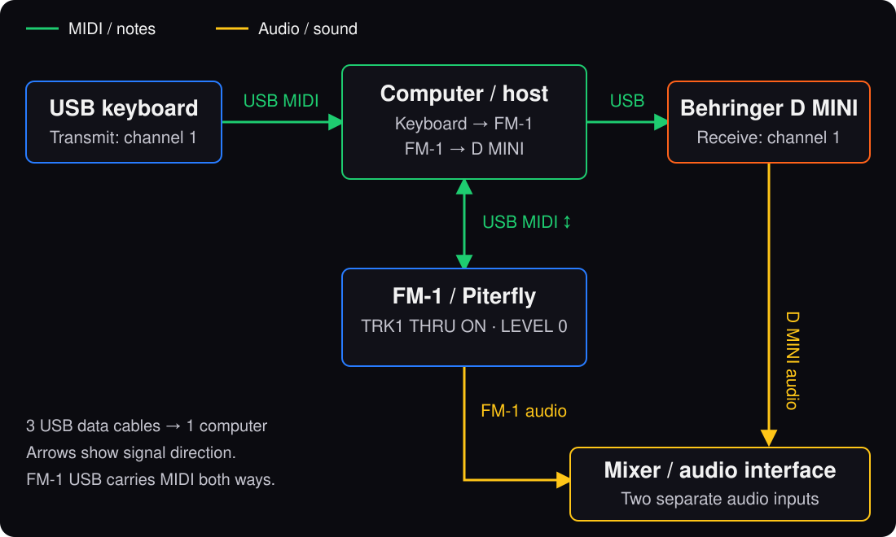](../assets/piterfly/midi-rig.svg)

Zielone strzałki pokazują drogę nut MIDI; żółte — osobne wyjścia audio. Wszystkie trzy urządzenia USB łączą się z komputerem osobnymi kablami do danych. Strzałka FM-1 ↔ komputer oznacza dwukierunkowe MIDI w jednym kablu USB.

Klawiatura USB, FM-1 i D MINI są osobno podłączone USB do Maca; dźwięk z FM-1 i D MINI trafia osobnymi połączeniami audio do miksera lub interfejsu. W jednym **MyPipe** narzędzia są ustawione od góry: **MIDI In: klawiatura → MIDI Out: piterfly (Pass Through OFF) → MIDI In: piterfly → MIDI Out: D MINI**. Wersja 1.1.0 zgłasza port wejściowy i wyjściowy jako **piterfly**. Domyślne kanały to 1–7 dla syntezatorów i 10 dla perkusji; główny pipe nie wymaga Channel Router ani Channel Filter. Zapisz go przez **File → Save** i zostaw MidiPipe uruchomiony.

D MINI odbiera tylko kanał 1. Track 1 ma LEVEL = 0, **CH1 = 1** i **OUT = SEQ**; tracki 2–7 oraz perkusja grają wewnętrznie. Instrument z klawiatury wybierasz jej kanałem nadawania, a nie zaznaczeniem tracka na ekranie FM-1.

W piterfly włącz TRK1 THRU dla nut granych na żywo. Ustawienie MidiPipe „Pass Through OFF” ma inną rolę: kontroluje przepływ w programie na Macu. Używaj jednej drogi nut do D MINI, aby ich nie dublować.

W serwisie, w sekcji MIDI THRU strony **What changes?**, dostępny jest angielski poradnik **FM-1 + Behringer D MINI setup guide** z osobnymi schematami USB i audio, kolejnością MyPipe i ekranami ustawień.

## Co sprawdzono

| Zakres | Wykonana walidacja |
| --- | --- |
| Pamięć patternów | Pełne 24 miejsca, rotacja zapisu, kasowanie, symulowane przerwanie programowania flash, ochrona USR1 |
| Migracja | Stare A–D, zajęte USR4, ciepły/zimny restart w symulacji, PER3 → PER4, zapis 128 pozycji |
| SONG | Przejście przez 128 pozycji, zakończenie i zapętlenie, timing audio |
| UI | Render do framebufferów, granice ekranu, ostatni krok 64, dwa kursory, 20 000 losowych klatek |
| Bezpieczeństwo zapisu | Symulowany błąd flash i ponowienie, wygaszenie potwierdzeń, PENDING → SAVED, także przez rzeczywisty kod protokołu MIDI |
| WWW | Pełny zestaw testów oraz dodatkowe testy końcowych zmian; błędne pliki odrzucane bez zapisów, zgodność ze starszym protokołem |
| MIDI THRU | Routing, kanały, wyłączenie THRU, zwalnianie nut, USB/TRS i zachowanie ustawień |
| Build | Kompilacja, limity pamięci i weryfikacja paczki `.fwsc` |

**Wersja została sprawdzona na fizycznym FM-1 i zaakceptowana przez autora projektu.** Testy programowe uzupełniają tę weryfikację.

Najważniejsze testy: [pattern_bank_test.c](../tests/pattern_bank_test.c), [pattern24_test.c](../tests/pattern24_test.c), [pattern24_migration_test.c](../tests/pattern24_migration_test.c), [arranger_test.c](../tests/arranger_test.c), [save_safety_test.c](../tests/save_safety_test.c), [ui_pages_test.c](../tests/ui_pages_test.c), [test_web.mjs](../web/test_web.mjs).

Ta dokumentacja ma pierwszeństwo nad limitami i opisami czterech sekcji w zachowanych instrukcjach bazowego SLOOP: [GUIDE.md](../GUIDE.md) i [SLOOP.md](../SLOOP.md). Licencja pozostaje GPL-3.0; informacje o autorach i pochodzeniu są w [README.md](../README.md).

## Granular na żywo

W piterfly **1.1.0** na `master` dostępny jest **FX → INSERT → GRANUL**, niezależnie na każdym tracku. Gałka 1 (INSRT) zawsze wybiera typ efektu, gałka 2 (PARAM) wybiera parę, a gałki 3/4 edytują: **SIZE/DENSITY**, **PITCH/MIX**, **POS/SPREAD** lub **CAPTURE/BUF**. BUF jest informacją o pojemności, bez edycji. SELECT normalnie przechodzi między stronami FX. Pojemność i stan LIVE/FREEZE są stale widoczne. BUF podaje rzeczywiście dostępny czas historii, zależny od liczby instancji, silników i pozostałych efektów.

Zmiana barwy, silnika lub presetu użytkownika zachowuje aktywny GRANUL, jego ustawienia i zamrożone audio. LIVE przechwytuje nową barwę. Edycja odrysowuje tylko zmienione pola, bez czyszczenia całego ekranu. Linie podziału, marginesy i pozycje wartości są takie same jak w CHOR; status bufora i LIVE/FREEZE nie przesuwa siatki.

Historia jest mono, 22,05 kHz, zapisana stratnie jako µ-law; suchy sygnał zachowuje dotychczasową jakość. Zapisują się ustawienia, ale nagrane audio znika po wyłączeniu zasilania lub załadowaniu projektu. Nowe projekty FUN9 wymagają aktualnego układu firmware. Przed aktualizacją zachowaj kopię starego zapisu do ewentualnego powrotu.

[Obsługa, ograniczenia i wyniki testów](LIVE-GRANULAR.md).

## DUCK i wydajność granulara w 1.1.0

Wybierz ścieżkę syntezatora, otwórz **FX → FILTER** i pokrętłem **2** ustaw **DUCK ON/OFF**. Stopa ścisza tylko włączone cele; wspólny **MASTER → DUCK** określa głębokość. Perkusja pozostaje źródłem wyzwalania. Ustawienia celów zapisują się z patternem.

Praca ścieżek jest rozdzielana między oba rdzenie według zmierzonego kosztu. Przy **MIX = 0** granular po wygaszeniu efektu zatrzymuje przechwytywanie i przetwarzanie ziaren. Dotychczasowa historia pozostaje w pamięci; audio z okresu pauzy nie jest do niej dopisywane. Zwiększenie MIX przywraca efekt.

## Ekrany efektów i routingu

### GRANUL: parametry dźwięku i zamrożenie historii

Na INSERT wybierz GRANUL. Knob 2 zmienia parę parametrów; knobs 3 i 4 edytują pokazaną parę. Pierwszy ekran pokazuje SIZE/DENSITY, drugi CAPTURE/BUF z FREEZE. Pary PITCH/MIX i POS/SPREAD są dostępne pomiędzy nimi. BUF pokazuje aktualnie przydzielony czas historii.

| GRANUL: SIZE / DENSITY | GRANUL: FREEZE / BUF |
| --- | --- |
| <a href="../assets/piterfly/screenshots/piterfly-granular-sound.png">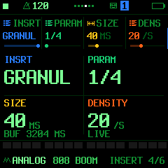</a> | <a href="../assets/piterfly/screenshots/piterfly-granular-source.png">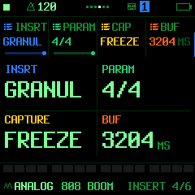</a> |

### DUCK: wybór reakcji ścieżki na stopę

Na wybranej ścieżce syntezatora otwórz **FX → FILTER**. Drugi parametr **DUCK** przełącza ON/OFF dla tej ścieżki. Głębokość pozostaje we wspólnym MASTER → DUCK. Ten przełącznik dotyczy wewnętrznego audio FM-1.

<a href="../assets/piterfly/screenshots/piterfly-duck.png">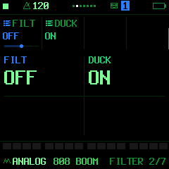</a>

### Kanały MIDI i THRU dla ścieżek 4–7

Dodatkowe ścieżki mają własne strony **MIDI 4-7** oraz **THRU 4-7**. Pierwsza ustawia ich kanały wyjściowe/wejściowe według routingu, druga niezależnie włącza przekazywanie nut. Oryginalna strona MIDI THRU zawiera TRK1–3 i DRUM.

| MIDI 4-7: kanały ścieżek | THRU 4-7: cztery osobne przełączniki |
| --- | --- |
| <a href="../assets/piterfly/screenshots/midi-tracks-4-7.png">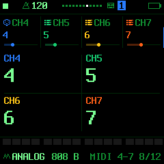</a> | <a href="../assets/piterfly/screenshots/midi-thru-tracks-4-7.png">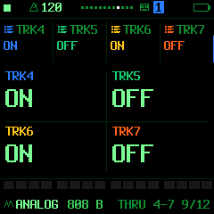</a> |
