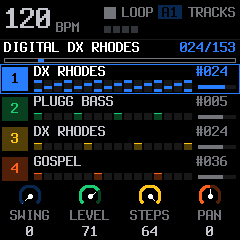

# piterfly 1.2.2 — HOME, LEVEL i patterny

17 listopada 2026. Zmiany względem publicznej wersji 1.2.0; wydanie obejmuje również lokalne poprawki 1.2.1.

## HOME: wiadomo, który instrument gra

- Pasek pod nagłówkiem pokazuje silnik, nazwę brzmienia oraz numer/liczbę brzmień, np. **DIGITAL DX RHODES — 024/153**.
- Cienka obwódka z klockiem pokazuje pozycję instrumentu na liście. Pasek nie jest miernikiem głośności i nie zapełnia się jak progress bar.
- Wiersze tracków pokazują numer brzmienia, np. **#024**. Taki sam numer na innych trackach identyfikuje tę samą pozycję listy. Wybranie numeru nie kopiuje ręcznie zmienionych parametrów.
- Liczba obejmuje brzmienia fabryczne i zapisane presety użytkownika, bez dodatkowych kopii z listy ulubionych. Perkusje pokazują numery swoich zestawów.
- Zachowano obie grupy tracków, pełne siatki do 64 kroków, znaczniki odtwarzania, ramki wyboru/nagrywania oraz pierwszeństwo komunikatów REC/SOLO/MUTE.

## LEVEL i przełączanie

Pokrętła **LEVEL, STEPS i PAN** na głównym panelu zachowują zmiany po przejściu A1 → A2 → A1, także gdy wybierasz zwykłe **LOAD** ze strony SONG lub edytora. Poprzednio ta ścieżka omijała zachowywanie opuszczanego patternu. Zapis przez menu przypisuje roboczy loop do zapisanego slotu. HOME perkusji 7 odczytuje i zmienia jej własny poziom zamiast globalnego poziomu perkusji 8.

Przełączenie podczas grania czeka na koniec pełnego obiegu najdłuższej bieżącej ścieżki, uwzględniając **LEN i DIV**, z zaokrągleniem do pełnych taktów. Przy DIV 1/16: 16 kroków = jeden takt, 32 = dwa, 64 = cztery. Szybki CHAIN także respektuje pełną długość, nawet 128 taktów przy 64 krokach DIV 2BAR. Zapisywana aranżacja SONG nadal stosuje BARS każdej pozycji.

Zachowywane są również instrumenty, presety, kity i sekwencje oraz edycje wykonane podczas oczekiwania na przejście. Chwilowe parameter locks nie zastępują wartości bazowych. Pełne cztery bufory oczekujących edycji odmawiają dalszego przełączenia z **STOP TO SAVE MORE**, chroniąc zmiany. Nowy projekt i import roboczego loopa odłączają go od wcześniejszego slotu.

Zmiany najpierw trafiają do RAM. Przed wyłączeniem zasilania zatrzymaj odtwarzanie, puść nuty i poczekaj na **PATTERNS SAVED**. Loop bez przypisanego slotu trzeba najpierw zapisać do patternu.

## Zgodność

Projekty z **1.2.0 i 1.2.1** pozostają zgodne: **FUNB**, 6160 bajtów, ustawienia **PER4**, edytor **protocol 19**, sześć syntezatorów i dwie perkusje. Nie zmieniono układu flash ani identyfikatora aktualizatora **FM-1_1120101**. Starsze FUN1–FUNA nadal nie są importowane. Edytor 1.2.0 z protokołem 19 jest zgodny.

## Weryfikacja i pliki

Wydanie zawiera instalowalny `.fwsc`, aplikację, loader, dokładne źródła, licencje, odpowiadający podgląd WASM, metadane builda i SHA256SUMS. Kod rysowania jest kompilowany jako osobne funkcje z optymalizacją rozmiaru, aby zachować funkcje w limicie flash; nie zwiększa zużycia RAM. Szczegóły testów i sum znajdują się przy plikach wydania.

Regresje obejmują rzeczywiste wejścia pokręteł LEVEL/STEPS/PAN oraz LOAD i przełączanie live na wszystkich ośmiu trackach, zachowanie brzmień i poziomów, różne LEN/DIV, pełny bufor, ponowny odczyt flash oraz HOME: identyfikatory, oba końce paska, zmianę bez pełnego odrysowania i niezależne zestawy perkusyjne. Testy UI sprawdzają też 64 kroki i ramki nagrywania w zmienionym układzie.

Test fizycznego FM-1 pozostaje do wykonania. Weryfikacja programowa nie zastępuje odsłuchu i testu panelu na urządzeniu.

[Instrukcja po polsku](PITERFLY.md) · [Build](../BUILDING.md) · [Wydanie i pobieranie](https://github.com/piotrwozniak/piterfly/releases/tag/1.2.2)
