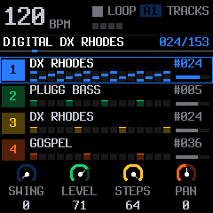

# piterfly 1.2.3 — linia pozycji instrumentu

17 listopada 2026. Mała poprawka wyglądu HOME względem 1.2.2.

Szara obwódka wskaźnika instrumentu została zastąpiona cienką poziomą linią przez środek klocka pozycji. Linia ma pełną szerokość wiersza (240 pikseli). Wskaźnik jest podniesiony o 3 piksele, z odstępem od ramki pierwszego tracka. Nazwa, licznik brzmień i numery przy trackach zachowują swoje znaczenie.

Bez zmian w audio, sterowaniu, MIDI i zapamiętywaniu LEVEL/STEPS/PAN. Projekty 1.2.0–1.2.2 pozostają zgodne: FUNB, 6160 bajtów; ustawienia PER4; edytor protocol 19; identyfikator aktualizatora FM-1_1120101. Edytor protokołu 19 pozostaje zgodny.

Sprawdzenie tej poprawki obejmuje renderer HOME, oba końce linii, jej szerokość, brak obwódki i odstęp od tracka, odrysowanie, obie perkusje oraz testy panelu i zapamiętywania wartości. Dołączono firmware, aplikację, loader, dokładne źródła, licencje, odpowiadający podgląd WASM, BUILD_INFO i SHA256SUMS. Fizycznego FM-1 nie testowano.

[Instrukcja](PITERFLY.md) · [Wydanie](https://github.com/piotrwozniak/piterfly/releases/tag/1.2.3) · [Zmiany 1.2.2](RELEASE-1.2.2.md)
