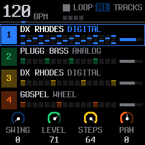

# piterfly 1.2.4 — przywrócony oryginalny HOME

Naprawa regresji interfejsu wprowadzonej w **1.2.2** i zachowanej w **1.2.3**. Tamte wersje dodały pas wysokości 24 px nad trackami, przesunęły je z y=40 do y=64 i zmniejszyły wysokość z 36 do 30 px. Była to nieuzgodniona zmiana układu.

## Co przywrócono

- Tracki: oryginalne 36 px, początek na y=40; cztery wiersze zajmują y=40–183.
- Oryginalne pozycje napisów, numerów tracków, nazw silników i brzmień, wysokości siatek kroków oraz pasków LEVEL.
- Oryginalne dolne pokrętła od y=184. Czcionki pozostają takie jak przed 1.2.2.
- Usunięto dodatkowy pas nazwy/licznika i numery brzmień # przy trackach. Dodany wskaźnik to wyłącznie cienka linia i klocek w pustych rzędach y=35–37 istniejącego nagłówka.

## Co pozostaje naprawione

Zachowano poprawki LEVEL/STEPS/PAN oraz brzmień przy przełączaniu i zwykłym LOAD. Przełączenie live nadal uwzględnia pełny najdłuższy obieg LEN/DIV. Bez zmian w audio, MIDI i przechowywaniu projektów: FUNB 6160 bajtów, PER4, protocol 19, FM-1_1120101. Projekty 1.2.0–1.2.3 są zgodne.

## Sprawdzenie układu

Renderer bazowy pochodzi z publicznego tagu `1.2.0` (identyczny z `fe74608`), sprzed dodania pasa w 1.2.2. Porównanie obejmuje wszystkie piksele poza trzema rzędami samego wskaźnika: 8 tracków, 2 palety i 4 stany (STOP, PLAY, REC/PENDING i SOLO). Oprócz zapisanego testu kontrolnego wykonano bezpośrednie porównanie każdego piksela z oryginalnym rendererem. Testy UI sprawdzają oryginalną geometrię, siatkę 64 kroków i ramki nagrywania. Testy zapamiętywania parametrów pozostają w zestawie. Fizycznego FM-1 nie testowano.

[Instrukcja](PITERFLY.md) · [Wydanie](https://github.com/piotrwozniak/piterfly/releases/tag/1.2.4)
