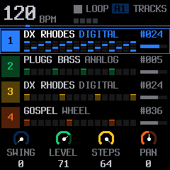

# piterfly 1.2.5 — informacje o instrumentach na HOME

- Nazwa brzmienia i silnik przy każdym tracku, także nieaktywnym; długie nazwy skracane do dostępnego miejsca.
- Numer **#XXX** przy każdym tracku, od #001, zaczynający się nad początkiem paska głośności. Dla obu perkusji numer oznacza zestaw perkusyjny. REC/SOLO/MUTE chwilowo zastępuje numer, zgodnie z zatwierdzonym zachowaniem.
- Bez licznika aktualny/wszystkie i bez dodatkowego pasa nad trackami.
- Bez zmiany wymiarów tracków, czcionek, siatki kroków, pasków LEVEL, pokręteł i wskaźnika instrumentu w nagłówku.
- Zachowane poprawki LEVEL/STEPS/PAN, instrumentów i przełączania po pełnym obiegu LEN/DIV. FUNB, PER4, protokół 19 i zgodność projektów 1.2.0–1.2.4 bez zmian.

Testy programowe i porównanie pikseli układu; test fizycznego FM-1 pozostaje do wykonania.

[Instrukcja](PITERFLY.md) · [Instalator](https://piotrwozniak.github.io/piterfly/webapp/installer/)
