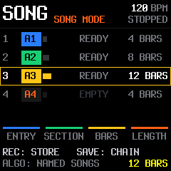

# piterfly 1.2.6 — zapis po kasowaniu i nowy utwór

- Przytrzymaj **REC**, by wyczyścić ścieżkę. Gdy transport jest zatrzymany i dźwięk wybrzmi, urządzenie zapisuje zmianę z pominięciem zwykłej przerwy między autosave'ami. **CLEAR SAVED** potwierdza zapis do flash. Przywrócenie identycznej wcześniejszej pętli również zapisuje ją jako najnowszy stan.
- Na zatrzymanym urządzeniu otwórz **SONG** i obróć **ALGORITHM**, by wejść do **SONGS**. Dwa naciśnięcia **REC** w ciągu trzech sekund tworzą pusty bieżący utwór. **NEW SONG** potwierdza wyczyszczenie roboczej pętli, wszystkich 24 roboczych slotów patternów i kolejności. Nazwane kopie pozostają w bibliotece. **OCT− dwa razy** usuwa wybrany zapis z biblioteki i pozostawia bieżącą sesję otwartą.
- W **SONG** zaznaczony wiersz ma pełną cienką ramkę w kolorze ustawionego w nim patternu.

Wydanie zachowuje zgodność z projektami 1.2.0–1.2.5. Format to **FUNB** (6160 bajtów), ustawienia **PER4**, protokół edytora **19**, identyfikator aktualizatora **FM-1_1120101**.

Sprawdzono renderowanie panelu, restart na symulowanej pamięci flash, przerwane zapisy i kompilację dla FM‑1. Próba na fizycznym FM‑1 pozostaje do wykonania.

[Instrukcja](PITERFLY.md) · [SONGS](SONGS.md) · [Instalator](https://piotrwozniak.github.io/piterfly/webapp/installer/)
