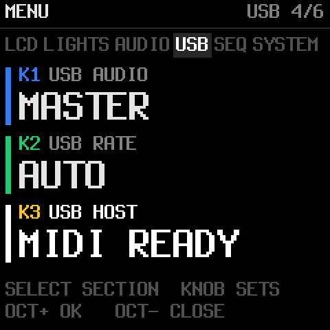

# Piterfly 1.2.7 — USB MIDI Host

FM-1 może grać na jednym zewnętrznym syntezatorze USB MIDI 1.0 bez komputera. Podłącz **FM-1 → hub USB z własnym zasilaczem → syntezator**, np. Behringer JT-4000M. Na FM-1 przytrzymaj **HOME**, obróć **SELECT** do zakładki **USB** i włącz **K3 (USB HOST)**. Gdy pojawi się **MIDI READY**, dopasuj kanał odbioru syntezatora do kanału ścieżki. **GLO → MIDI 2 → OUT = SEQ** wysyła też zapisane patterny. Odsłuch podłącz do wyjścia audio syntezatora.

Zakładka **USB** zawiera też **USB AUDIO** i **USB RATE**. K3 w lewo przywraca tryb USB używany przez komputer, edytor i instalator. FM-1 uruchamia się w tym trybie.

Wydanie zachowuje **24 patterny, 128 pozycji SONG i 352 KiB pamięci songów**. Projekty od 1.2.0 pozostają zgodne. Format **FUNB** ma 6160 bajtów, ustawienia to **PER4**, protokół edytora **19**, a identyfikator aktualizatora **FM-1_1120101**. Zduplikowane definicje brzmień fabrycznych zestawów SYN współdzielą dane. Zestawy i ich brzmienia zachowują dotychczasowe parametry.

Obsługę huba, wysyłanie MIDI, ponowne połączenie i powrót do trybu USB urządzenia sprawdzono w testach programowych. Działanie USB Host z fizycznym FM-1, hubem i JT-4000M wymaga jeszcze próby sprzętowej.

[Instrukcja podłączenia](PITERFLY.md#usb-midi-host-bez-komputera) · [JT-4000M Micro – Behringer](https://www.behringer.com/en/products/0722-ACI) · [Instalator](https://piotrwozniak.github.io/piterfly/webapp/installer/)
