# Piterfly 1.1.0 — ekrany urządzenia FM-1

[Instrukcja](PITERFLY.md) · [Wydanie 1.1.0](RELEASE-1.1.0.md)

Każdy obraz poniżej odwzorowuje **rzeczywisty ekran FM-1 o rozdzielczości 240 × 240**. Powstaje bezpośrednio z kodu UI firmware, z przykładowymi danymi. Nie jest zdjęciem fizycznego wyświetlacza. Galeria przedstawia HOME, warstwę SAVE, SONG, INSERT, FILTER i GLO urządzenia. Kliknij obraz, żeby otworzyć oryginał.

Na HOME urządzenie pokazuje cztery ścieżki z jednej z dwóch grup. Warstwa SAVE pokazuje cztery sloty z jednego z sześciu banków. Przykład zawiera zajęte A1/A2 i pozostałe wolne sloty. Nie ma tu zrzutów desktopowego edytora ani jego mocka.

## HOME — ścieżki 1–4

Pierwsza grupa czterech ścieżek.

<a href="../assets/piterfly/screenshots/home-64.png">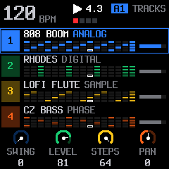</a>

## HOME — ścieżki 5–8

Druga grupa: syntezatory 5–7 i perkusja 8. Syntezator 4 jest w pierwszej grupie.

<a href="../assets/piterfly/screenshots/home-tracks-5-8.png">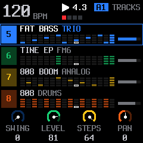</a>

## SAVE — banki A–F: 24 sloty

Przytrzymaj SAVE i wybierz bank pokrętłem KNOB 1. Sześć ekranów pokazuje po cztery sloty: górny rząd wybiera pattern, zielony zapisuje, czerwony kasuje.

| Bank A: A1–A4 | Bank B: B1–B4 | Bank C: C1–C4 |
| --- | --- | --- |
| <a href="../assets/piterfly/screenshots/save-bank-a.png">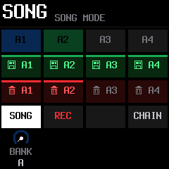</a> | <a href="../assets/piterfly/screenshots/save-bank-b.png">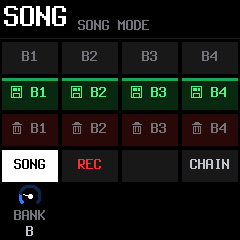</a> | <a href="../assets/piterfly/screenshots/save-bank-c.png"></a> |

| Bank D: D1–D4 | Bank E: E1–E4 | Bank F: F1–F4 |
| --- | --- | --- |
| <a href="../assets/piterfly/screenshots/save-bank-d.png">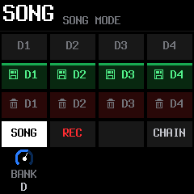</a> | <a href="../assets/piterfly/screenshots/save-bank-e.png">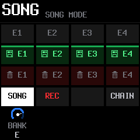</a> | <a href="../assets/piterfly/screenshots/save-bank-f.png"></a> |

## SONG — pozycje 63–67

Kolejność przechodzi ponad 64. Każdy wiersz wskazuje pattern i liczbę taktów.

<a href="../assets/piterfly/screenshots/song-positions-63-67.png">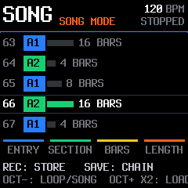</a>

## SONG — pozycja 128

Ostatnie pozycje 125–128 w przykładowej kolejności z patternami A1/A2.

<a href="../assets/piterfly/screenshots/song-position-128.png">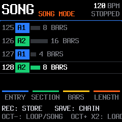</a>

## GLO — 64 kroki

Dolny podgląd wybranej ścieżki z pozycją odtwarzania.

<a href="../assets/piterfly/screenshots/glo-64.png">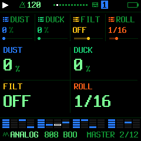</a>

## REC READY

Widok kroków podczas przygotowania nagrania.

<a href="../assets/piterfly/screenshots/rec-ready-64.png">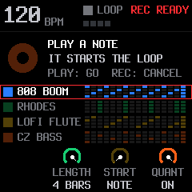</a>

## GRANUL — SIZE / DENSITY

Pierwsza para parametrów live INSERT GRANUL.

<a href="../assets/piterfly/screenshots/piterfly-granular-sound.png">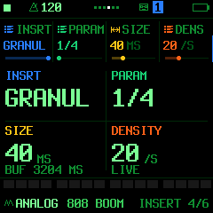</a>

## GRANUL — PITCH / MIX

Wysokość ziaren i udział efektu.

<a href="../assets/piterfly/screenshots/granular-pitch-mix.png">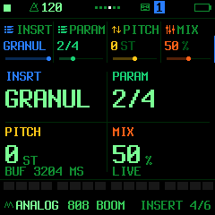</a>

## GRANUL — POS / SPREAD

Pozycja w historii i rozrzut ziaren.

<a href="../assets/piterfly/screenshots/granular-pos-spread.png">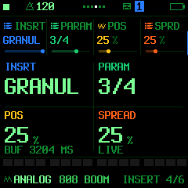</a>

## GRANUL — CAPTURE / BUF

FREEZE i aktualnie przydzielony czas historii.

<a href="../assets/piterfly/screenshots/piterfly-granular-source.png">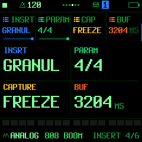</a>

## FILTER — DUCK

Przełącznik ON/OFF reakcji wybranej ścieżki syntezatora na stopę.

<a href="../assets/piterfly/screenshots/piterfly-duck.png">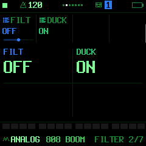</a>

## MIDI — pierwotne kanały

Kanały syntezatorów 1–3 oraz perkusji.

<a href="../assets/piterfly/screenshots/piterfly-midi-channels.png">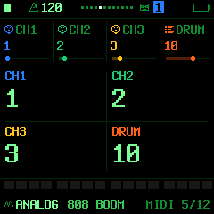</a>

## MIDI 4-7

Osobne kanały syntezatorów 4–7.

<a href="../assets/piterfly/screenshots/midi-tracks-4-7.png">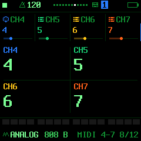</a>

## MIDI THRU

Przełączniki TRK1–3 i DRUM.

<a href="../assets/piterfly/screenshots/piterfly-midi-thru.png">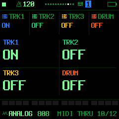</a>

## THRU 4-7

Niezależne przekazywanie nut ścieżek 4–7.

<a href="../assets/piterfly/screenshots/midi-thru-tracks-4-7.png">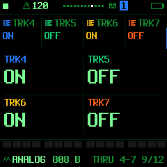</a>

## MIDI 2 — IN / OTHER / OUT

IN NOTES, OTHER OFF i OUT SEQ dla przykładowego zestawu z D MINI.

<a href="../assets/piterfly/screenshots/piterfly-midi-input.png">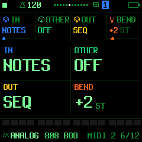</a>

## HOME — zewnętrzne brzmienie ścieżki 1

LEVEL 0 wycisza wewnętrzne audio; nuty MIDI ścieżki nadal mogą sterować D MINI.

<a href="../assets/piterfly/screenshots/piterfly-midi-home.png">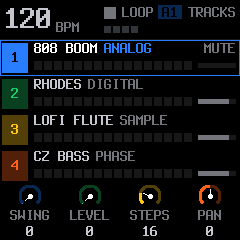</a>

## Źródło obrazów

`tools/render_ui_docs.c` kompiluje rzeczywiste pliki `ui.c`, `ui_draw.c`, `ui_studio.c`, `ui_layers.c`, `ui_song.c`, `ui_menu.c` i `ui_input.c` w konfiguracji siedmiu syntezatorów i perkusji. Przykładowy stan przygotowuje tylko na potrzeby ilustracji; nie zmienia układu ani treści etykiet rysowanych przez firmware.

```sh
cc -O2 -w -Ibuild/gen -Ifirmware/src -Ifirmware/hal tools/render_ui_docs.c -lm -o build/render_ui_docs
mkdir -p build/ui-docs
build/render_ui_docs build/ui-docs
```

Wynikowe PPM są zapisywane jako PNG bez zmiany rozdzielczości. W dokumentacji obrazy można powiększać, ale ich zawartość pozostaje ekranem 240 × 240 urządzenia.
