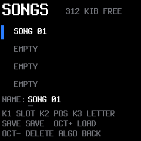

# Named songs — piterfly 1.2.4

The 6+2 firmware supports **eight named song slots, subject to free flash space**. A song contains its order (up to 128 entries), nonempty stored patterns and the current working loop. Loading a song replaces all 24 working pattern slots, including clearing absent patterns. Song files contain sequencer/project data, not a rendered audio recording.

Example screen rendered from the firmware; not a photograph of the physical display.

## On the FM-1

Stop playback. Open SONG and turn ALGORITHM to open SONGS. K1 or PRESETS selects a slot; K2 selects a character position; K3 edits the name (15 characters maximum). SAVE stores. Replacing an occupied slot needs a second SAVE within three seconds. OCT+ twice loads the selected song; OCT− twice deletes it. ALGORITHM or HOME returns to the order editor.

SAVE on the ordinary SONG order page retains its previous meaning: saving the current order. Saving an independent named song happens in the SONGS list.

## On the Mac

Use the protocol-19 editor (the 1.2.0 editor remains compatible), connected by USB MIDI, and open Song. The device-song list has Save, Load, Export and Delete controls. Export reads the selected snapshot directly, without changing the current project. It verifies lengths and CRCs and downloads a `.sloopsong` file. Changing/replacing/deleting that snapshot during export causes an error instead of mixing versions.

Export never deletes automatically. Check the downloaded file before deleting its device entry. To restore, import the file using the existing song-file control, then save the restored working project into a named slot. Existing current-project export remains available.

**Current-project backup and current-project export do not include the entire saved-song library. Export each named entry separately.** SYN1–SYN4 definitions and the FM6 user-patch bank remain shared device libraries, as before; song snapshots/files preserve selections and parameters, but do not copy these libraries. Preserve those separately with the existing backup. Device preferences, MIDI routing and temporary captured granular audio are not per-song archives.

## What actually fits

The physical pool is **44 blocks × 8 KiB = 352 KiB**. Reclaiming the final user-sample bank adds 80 KiB to the previous 272 KiB pool. All USR sample banks are now unavailable; factory samples and factory/SYN drums remain.

| Allocation | Physical space |
| --- | --- |
| Each distinct nonempty stored pattern | 8 KiB (6,160-byte project plus journal overhead) |
| Working-loop snapshot | 8 KiB; alternating autosaves can retain a second block |
| Each used song-directory slot (a deleted slot retains a journal tombstone) | 8 KiB |
| Active-workspace directory | 8 KiB |
| Reserved block for deletion/recovery | 8 KiB, excluded from displayed free space |

Unchanged records can be shared across songs, including the currently loaded working project. Empty stored patterns are omitted. Notes on muted tracks or outside the active loop length still count; a pattern with only sound settings and no notes/hits is omitted. The working loop is always retained, including its settings. Completely empty songs are refused.

Consequently, there is **no fixed number of full songs implied by 352 KiB**. Two independent songs with 24 different patterns each cannot fit: their patterns alone need 384 KiB. Three independent eight-pattern songs, or eight small three-pattern songs, fit in a clean pool when the current work is one of those songs and no additional unrelated working data is retained. Later edits may need additional blocks. The eight directory slots remain the maximum even if the songs are tiny.

The device and editor display available KiB. At capacity, **NO SPACE: EXPORT/DELETE** refuses the save and retains the previous complete named snapshot. A failed replacement may leave valid new working records allocated, but does not replace the saved directory entry until all its data has committed.

The deletion tombstone keeps the slot’s 8 KiB metadata block allocated so old versions cannot reappear after a restart. Deleting an entry releases only pattern/loop records no longer referenced by another saved song or the current working project. Deleting the currently loaded song keeps the current work; load another song to release its unshared working data. One block is reserved so deletion can still commit after a normal save runs out of space. Delete has confirmation and no undo.

## Compatibility and verification

This build uses **FUNB**, 6,160-byte projects, PER4 settings and protocol **19**. Earlier FUN1–FUNA projects are not imported. Removing user kits shifts SYN kit IDs, so experimental FUNA projects are also incompatible. Back up and export earlier work before installing. No automatic migration or device flashing is performed by these source changes.

`tests/song_library_test.c` checks sparse saves, shared-record reuse, independent loads, cold scans, full-space deletion and injected write failures during replacement. `web/test_device_songs.mjs` exports/imports songs through the actual C firmware’s protocol against simulated NOR flash. These checks complement the target build; physical buttons, USB transfer and power cycling on an FM-1 still need validation.
